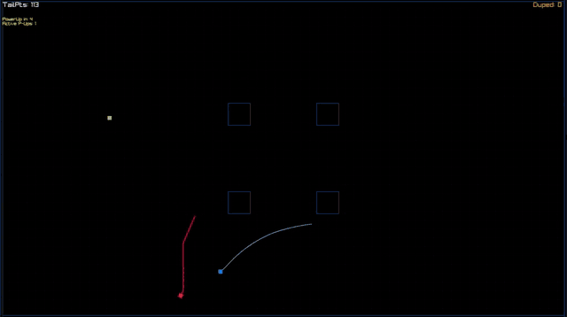
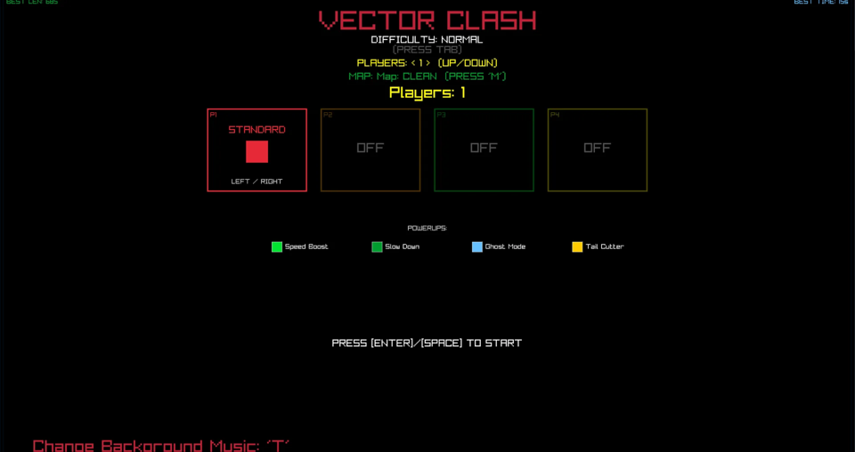
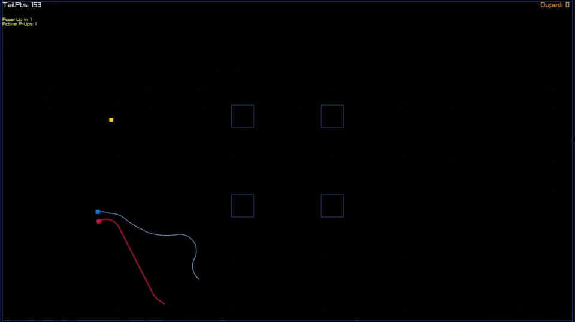
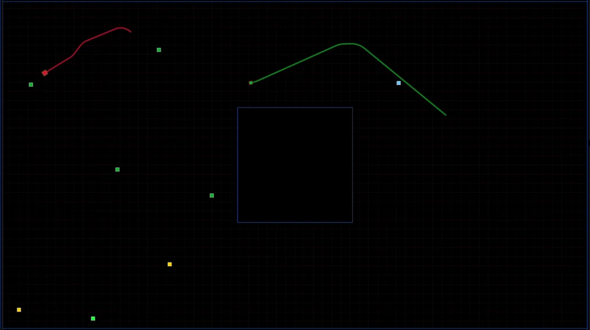
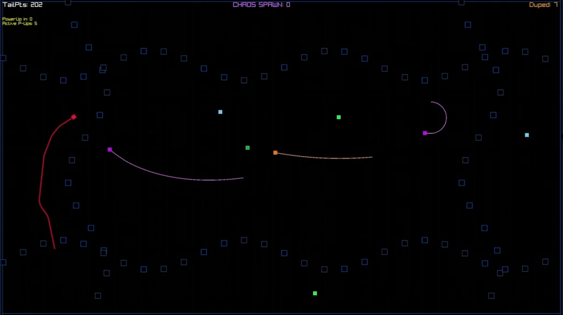

# Vector Clash



A Tron style light bike arena for 1 to 4 players on one keyboard. Your bike leaves a trail. Hit a wall or a trail and you're out. Cut people off, last one alive wins. In solo mode AI bikes hunt you instead.

I made it for my Programming 1 exam at INN (autumn 2025). C++ and raylib, my own vector class for all the movement math.

**Play it in the browser:** [sundorigin.org/vector-clash.html](https://sundorigin.org/vector-clash.html) or on [itch.io](https://rillianz.itch.io)

| | |
| --- | --- |
|  |  |
|  |  |

## What's in it

- **1 to 4 players** on one keyboard, or solo against AI bikes. Trick them into crashing to raise your "duped" count. On Hard and Chaos more of them keep showing up.
- **4 bikes.** Standard, Viper (fast and twitchy, tiny), Bruiser (slow, huge, grows tail fast) and Ghost (quick, barely leaves a tail)
- **6 maps.** Clean, Fixed, Wave (sine waves), Donut, Grid and Chaos (new random obstacles every round)
- **4 difficulties.** Easy, Normal, Hard and Chaos
- **Power ups.** Speed boost, a fake one that slows you down (sorry), Ghost mode to phase through trails, and Tail Cutter
- Gamepad support, 6 music tracks, a spawn shield after the countdown, solo high scores saved to a file

## Controls

| | Turn left | Turn right |
| --- | --- | --- |
| Player 1 (red) | Left arrow | Right arrow |
| Player 2 (orange) | A | D |
| Player 3 (green) | F | H |
| Player 4 (yellow) | J | L |

In the menu:

| Key | What it does |
| --- | --- |
| Up / Down | Number of players |
| Each player's turn keys | Pick a bike |
| M | Next map |
| Tab | Difficulty |
| T | Next music track |
| Enter / Space | Start |
| Space / Enter on game over | Play again / back to menu |

**Gamepads:** gamepad 1 steers player 1 and so on (d-pad or left stick). In the menu A or Start starts, d-pad up/down sets players, X changes difficulty, Y changes map, Back changes music and LB/RB pick your bike. On game over A retries and B goes back to the menu.

## Build it

**Windows, Visual Studio:** open `VectorClash.sln` and press F5. raylib is in `lib/`. Music and sounds load from `resources/`, so run it from the project folder (the default in Visual Studio) or put `resources/` next to the exe.

## Code

```
src/main.cpp           window and game loop
src/GameManager.*      states, menu, rounds, scoring, audio, saving
src/mPlayer.*          player bikes and input
src/Enemy.*            the AI bike
src/ITailOwner.h       shared trail logic for players and the enemy
src/BikeConfig.h       bike stats, all the balancing in one place
src/MapGenerator.*     the six maps
src/PowerUp.*          power ups
src/Vector2D.*         my own 2D vector math (normalize, rotate, sine and cosine movement)
```

## Notes

This is the newest version of the code. On top of the exam version it has gamepad support (pad N steers player N) and a 4 second spawn shield that starts after the GET READY countdown. The browser parts only switch on when you build with `PLATFORM_WEB`, so the same code builds for Windows too. All changes are marked `// [web-port]` or `// [gamepad]`, and [`web/WEB-PORT-NOTES.md`](web/WEB-PORT-NOTES.md) explains them plus the web build command.

The exact version I handed in for the exam is on the [`2025-exam`](https://github.com/RillianZ/vector-clash/tree/2025-exam) branch.

The ready to play browser build is in [`web/VectorClash-web.zip`](web/VectorClash-web.zip). Unzip it and serve the folder with any local web server, or upload it to itch.io as an HTML game. The music is free to use tracks I downloaded.

Made by Noah Sund, [Sund Origin Studio](https://sundorigin.org).
